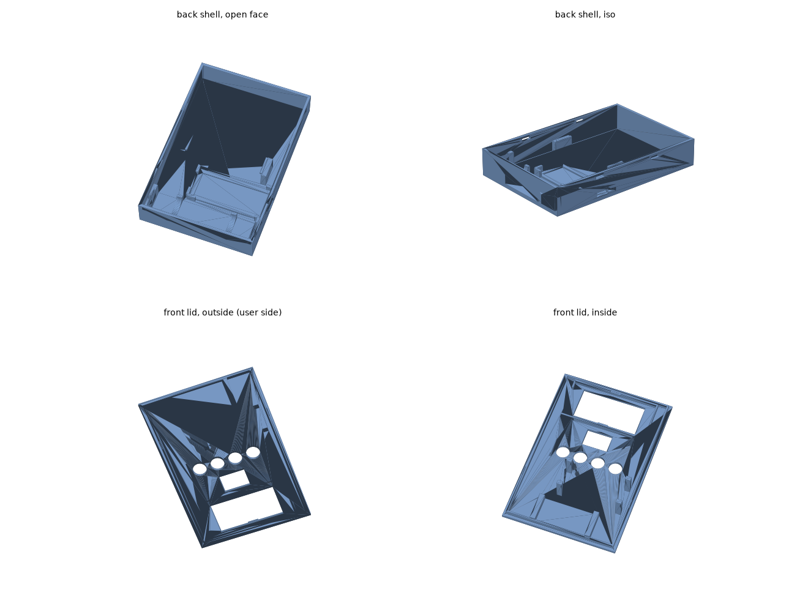

# ESP32 Matter switch

A battery-powered handheld switch that turns outlets on a TP-Link Tapo P304M (UK) Matter power strip on and off.
Built for a workshop master/slave pair (for example a table saw and a vacuum): on/off only, no power-draw sensing.

- A rocker switch picks **normal** or **slave** mode.
- **Normal mode:** *Send* toggles the selected outlet.
- **Slave mode:** *Send* toggles every outlet marked *master*, and every *slave* outlet takes the same state.
- A 2.13 in e-paper screen shows the mode, each outlet's role and state, and the battery level.
- Four buttons: **Select** (next outlet), **Role** (none / master / slave), **Send**, **Refresh**.

## Status

| Part | State |
|---|---|
| Switch logic (`lib/core`) | Done, unit-tested on a PC |
| Firmware (`src/main.cpp`) | Written, **not compiled or run on hardware yet**. Pins in `src/config.h` are planning values: check them against the board pinout |
| Case (`hardware/case`) | Parametric model, STL generated. **Not test-printed.** Dimensions are nominal, so measure your parts first |
| Control route | Hub route implemented. Direct binding and ESP32-as-controller are not |

## How it talks to the strip

The device is a Matter node that exposes 8 generic-switch endpoints (outlet 1 ON, outlet 1 OFF, and so on).
In your hub (Apple Home, Home Assistant, Google Home), create one automation per endpoint: when that button is pressed, turn the matching strip outlet on or off.
This keeps the ESP32 simple, but it needs a Matter hub running.

Open questions: events sent before the hub resubscribes after a wake are lost (tune `MATTER_SETTLE_MS`), and the real deep-sleep current and wake-to-send time are unmeasured.

## Build and flash

1. Install PlatformIO. The Matter library needs Arduino-ESP32 3.x, which `platformio.ini` selects through the pioarduino platform.
2. Copy `src/secrets.h.example` to `src/secrets.h` and enter your Wi-Fi details. The file is git-ignored.
3. `pio run -t upload`, then open the serial monitor for the Matter pairing code and add the device in your hub.
4. Hold **Refresh** for 8 s right after a wake to decommission and pair again.

Logic tests (no hardware): `g++ -std=c++17 -Ilib/core test/test_logic.cpp lib/core/switch_logic.cpp -o /tmp/t && /tmp/t`

## Wiring (verify against your boards)

Each input goes to GND through its switch, with an external 1 MΩ pull-up to 3V3. The internal pull-ups leak far more in deep sleep.
Only GPIO0 to GPIO7 can wake the ESP32-C6 from deep sleep.

| Signal | GPIO |
|---|---|
| Rocker (closed = slave mode) | 0 |
| Select / Role / Send / Refresh | 1 / 2 / 3 / 4 |
| e-paper SCK / MOSI / CS / DC / RST / BUSY | 23 / 22 / 18 / 19 / 20 / 21 |
| Fuel gauge SDA / SCL (optional) | 6 / 7 |

## Case

`hardware/case/case.py` builds two parts with no screws: a back shell with an 18650 cradle, ESP32 pocket, button-board ledges and a USB-C slot, and a snap-fit lid with the display window, four button holes and the rocker cutout.
Run `python hardware/case/case.py` (needs `trimesh`, `manifold3d`, `numpy`, `networkx`, `scipy`) to regenerate `hardware/case/stl/`.
Print the back open-face up and the lid outside-face down, in PETG.

## Bill of materials

Prices are rough GBP estimates including VAT from UK listings in November 2026; AliExpress listings change often, so check dimensions and seller ratings.
Buy the 18650 cell from a UK authorised dealer, not AliExpress.

| Type | Item | Model | Qty | Est. unit price |
|---|---|---|---|---|
| Core | Tapo smart Wi-Fi power strip, 4 outlets (UK) | Tapo P304M | 1 | £30.00 |
| Core | DFRobot FireBeetle 2 ESP32-C6 board | DFR1075 | 1 | £5.70 |
| Core | Waveshare 2.13in e-Paper HAT, black/white, 250x122, SPI | Waveshare 2.13inch e-Paper HAT (V4) | 1 | £14.40 |
| Core | Protected 18650 cell, 3000 mAh, button top | BAK N18650CK (protected) | 1 | £5.45 |
| Core | 18650 spring and flat contact plates for a printed cell bay (pack) | Generic 18650 battery contact set | 1 | £3.00 |
| Core | Mini rocker switch, SPST 2-pin (normal / slave mode) | KCD11 mini rocker (check cutout size in the listing) | 1 | £1.50 |
| Core | 12 x 12 mm tactile click switches with caps (pack of 10) | Generic 12x12x7.3 mm tactile switch | 1 | £3.00 |
| Core | 1 MΩ 1/4 W resistors (pack of 20) | Generic 1M 1/4W | 1 | £2.00 |
| Core | 26 AWG silicone hookup wire, 6 colours | Generic 26AWG silicone wire | 1 | £6.00 |
| Core | JST-PH 2.0 mm 2-pin pigtail cables (pack of 10) | Generic JST-PH2.0 2-pin with wire | 1 | £3.00 |
| Core | Perfboard 5 x 7 cm (pack) | Generic 5x7 cm perfboard | 1 | £3.00 |
| Core | PETG filament, 1 kg | Any PETG, 1.75 mm | 1 | £18.00 |
| Core | M3 brass heat-set inserts and M3 screw kit | Generic M3 insert and screw kit | 1 | £8.00 |
| Core | Kapton tape, 10-20 mm wide | Generic polyimide tape | 1 | £3.00 |
| Optional | Fuel gauge breakout, MAX17048 (STEMMA JST-PH / QT) | Adafruit ADA5580 (5580) | 1 | £5.80 |
| Optional | 470 µF 6.3 V low-ESR capacitor | Generic 470uF 6.3V | 1 | £1.00 |
| Alternative | DFRobot FireBeetle 2 ESP32-S3 (N4) | DFR1145 | 1 | £10.00 |
| Tools | Soldering iron, USB-C powered | Pinecil V2 | 1 | £35.00 |
| Tools | Solder, 0.8 mm | Generic 0.8 mm solder | 1 | £6.00 |
| Tools | Multimeter with µA range, to measure sleep current | e.g. UNI-T UT61E+ class | 1 | £55.00 |

Core parts about £106, optional parts about £7, tools about £96. Alternative: a DFRobot FireBeetle 2 ESP32-S3 instead of the C6 if you run Matter controller firmware.

**Safety.** The build has no mains wiring. The strip is rated 3250 W / 13 A, but its motor rating is unclear: switch large induction motors through a motor-rated contactor and use the strip only as the signal. Protect the Li-ion cell, and insulate contacts with Kapton tape.

## License

MIT
